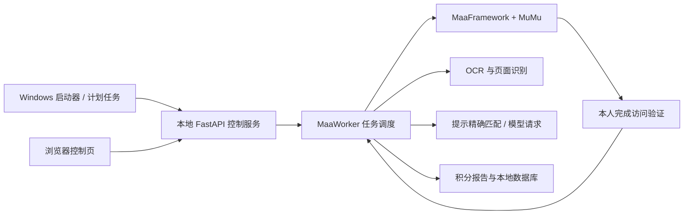

# 架构与维护

| 目录 | 职责 |
| --- | --- |
| `backend/webui.py` | 本地 HTTP / WebSocket 服务、配置与任务入口 |
| `backend/utils.py` | Worker 状态、Maa 回调、执行调度与每日答题 |
| `backend/*_tasks.py` | 阅读、视听、订阅、评论等独立任务 |
| `backend/daily_*.py` | 提示匹配、答题页面与提交恢复 |
| `backend/fun_challenge.py`、`four_player.py` | 趣味入口、单人和竞技模式 |
| `backend/screen_reading.py`、`question_visual.py`、`recognition_helpers.py` | OCR 复用、图片题分流和纯几何函数 |
| `backend/answer_client.py`、`provider_support.py` | 官方模型请求、配置与连通验证 |
| `scripts` | Windows 安装、启动、停止、定时、自检、离线复现 |
| `resource` | 上游识别模型、图片和任务管线 |
| `page` | 浏览器控制页 |
| `tests` | 离线回归与去身份化测试数据 |
| `config` | 示例文件以及本机配置（本机文件不提交） |

任务完成必须依据新读取的积分；“发出点击”“模型答完”均不能直接视为加分。遇验证时保留当前任务，待本人处理后恢复。网络错误最多进行既有的一次重试，不自动解验证。

公开整理沿用本地整理候选版本 `local-20261018.7`；其上游基线是 v1.7.1。公开分发标签使用 `v0.1.0-rc.1` 表示该衍生版本的发布成熟度，不冒充上游版本。私人开发历史保留在维护者本机，公开仓库从经检查的源码快照开始，完整归属信息见 [NOTICE](../NOTICE.md)。
